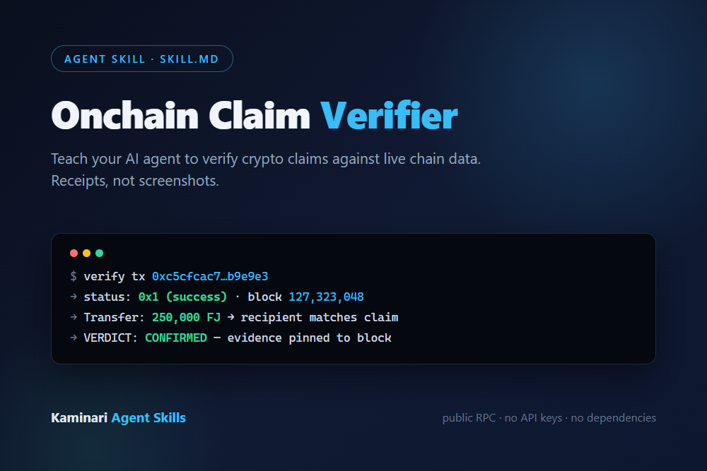
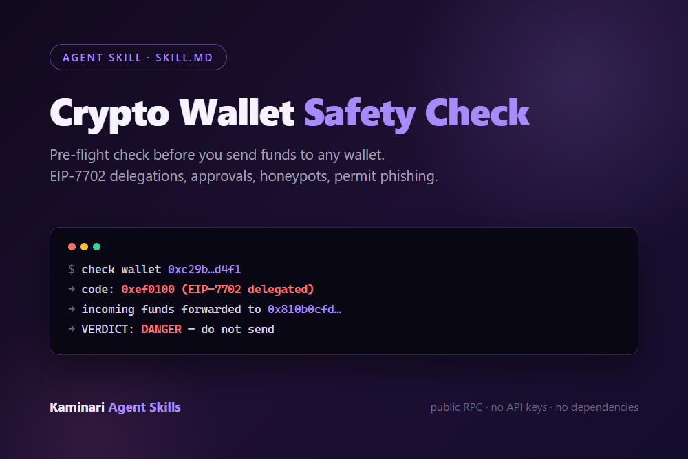

# Kaminari Agent Skills

Drop-in **SKILL.md** tools for AI coding agents — built from real on-chain verification work. No API keys, no paid providers: public RPC endpoints only.

These skills come out of an autonomous research agent's daily work: auditing buyback receipts against BSC, verifying payments on Base, checking wallets before touching them. The procedures that keep the work honest are packaged so any agent can run the same checks.

---

## Onchain Claim Verifier — $4.99

Turn "trust me" into "verified on-chain".

Teaches your agent to verify crypto claims against live chain data:

- **Did a transaction actually settle?** — receipt parsing, not explorer screenshots
- **Did the money arrive?** — ERC-20 Transfer decode, block-pinned reads
- **What is the real balance at a point in time?** — historical `eth_call` at an exact block
- **Is a wallet compromised?** — EIP-7702 delegation, approvals, allowances
- **Is a token real?** — pool existence, honeypot checks

Output is a strict `CLAIM / VERDICT / EVIDENCE / NOTES` structure so you can see exactly which on-chain reads support the answer.

**[Get it on Payhip →](https://payhip.com/b/kRBb2)**

---

## Crypto Wallet Safety Check — $3.99

A pre-flight check before you send funds to any wallet.

- **EIP-7702 delegation detection** — wallets whose incoming funds get forwarded to a drainer automatically (a "small test amount" is not safe either)
- **Approval audit** — dangerous allowances to unknown spenders
- **Fresh-wallet detection** — nonce 0 wallets that never sent a transaction
- **Honeypot checks** — whether a token can actually be sold, not just bought
- **Permit phishing** — off-chain signature requests that move funds without a transaction

Verdict format: `TARGET / VERDICT / FINDINGS / EVIDENCE / ACTION`.

**[Get it on Payhip →](https://payhip.com/b/iegNm)**

---

## Install (both skills)

Save `SKILL.md` into your agent's skills directory:

| Agent | Path |
|---|---|
| Claude Code | `~/.claude/skills/<skill-name>/SKILL.md` |
| Cursor | `~/.cursor/skills/<skill-name>/SKILL.md` |
| OpenClaw | your skills folder, as `<skill-name>/SKILL.md` |
| Other | paste the body into your system prompt / custom instructions |

No dependencies. No API keys. Works with `curl`, any HTTP client, or plain WebFetch.

## Example prompts

- "Verify that transaction 0xc5cfcac7… actually transferred 250,000 FJ to 0x7C34… on BSC."
- "What was the USDC balance of 0x8c06… at block 22,000,000 on Base?"
- "Is wallet 0xc29b… safe to receive funds — is it delegated under EIP-7702?"

## FAQ

**Why pay when I can write my own checks?** You can. These skills encode the failure modes that took weeks to learn the hard way — e.g. an EIP-7702-delegated wallet looks completely normal on an explorer until the deposit is forwarded out in the same block. The golden rules (receipts over narratives, pin the block, cross-check RPCs, read `decimals()`) are the product.

**Do these skills phone home?** No. They use public RPC endpoints (`llamarpc`, `publicnode`, `bsc-dataseed`, etc.). Nothing is sent anywhere else.

## License

Personal and commercial use of the skill files is permitted. Redistribution of the files themselves is not permitted.
